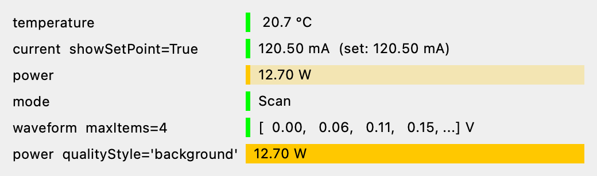
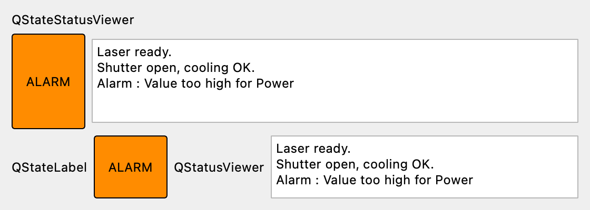
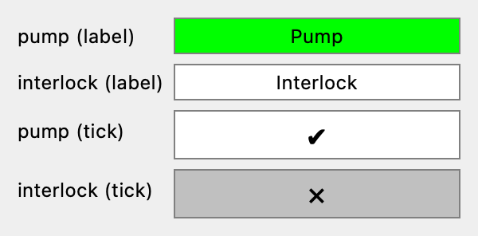

# Attribute viewers

Read-only widgets for one attribute or one device. Bind them with
`setModel("dom/fam/mem/attr")` (or `setDevice("dom/fam/mem")` where noted).

```python
from PyQTango.widgets import (QValueLabel, QStateLabel, QStatusViewer, QStateStatusViewer,
                              QBooleanLabel, create_viewer)
```

## QValueLabel



The generic viewer (ATK `SimpleScalarViewer`). It works for any attribute type:

* numbers are formatted with the attribute's Tango `format` (`%6.2f`...) and followed by the unit;
* enums show their label, states their name;
* spectra and images show their first values (`maxItems`, default 20);
* the quality is shown as a coloured left border (green valid, orange alarm or
  warning, grey invalid, blue changing) or, with `qualityStyle="background"`,
  as ATK's coloured background.

| Property | Default | Meaning |
| --- | --- | --- |
| `modelName` | `""` | Attribute name |
| `showUnit` | `True` | Append the unit |
| `showQuality` | `True` | Show the quality colour |
| `qualityStyle` | `"border"` | `"border"` or `"background"` |
| `showSetPoint` | `False` | Append the set point of a writable attribute: `120.50 mA (set: 120.50 mA)` |
| `formatOverride` | `""` | A printf format used instead of the attribute's |
| `maxItems` | `20` | Values shown for spectra and images |

```python
power = QValueLabel()
power.setModel("lab/laser/1/power")

current = QValueLabel()
current.setModel("lab/laser/1/current")
current.setShowSetPoint(True)
current.setFormatOverride("%.1f")

alarm = QValueLabel()
alarm.setQualityStyle("background")       # ATK look: the whole label in the quality colour
alarm.setModel("lab/laser/1/power")
```

A read error shows `#Err` in grey and puts the error in the tooltip.

## QStateLabel, QStatusViewer and QStateStatusViewer



* `QStateLabel` shows a `DevState` as its name on the ATK state colour.
* `QStatusViewer` is a read-only, wrapping text view of a Status (or any string) attribute.
* `QStateStatusViewer` is the device header of ATK panels: the state box next to
  the status text. Pass `orientation=Qt.Orientation.Vertical` to stack them.

`QStateLabel` and `QStatusViewer` accept either an attribute or a device (they
then use its `State` or `Status` attribute):

```python
header = QStateStatusViewer()
header.setDevice("lab/laser/1")

state = QStateLabel()
state.setDevice("lab/laser/1")              # same as setModel("lab/laser/1/State")

status = QStatusViewer()
status.setModel("lab/laser/1/Status")
```

The state spectrum viewer is on the [charts page](charts.md#list-viewers).

## QBooleanLabel



A `DevBoolean` viewer with two looks (ATK 10):

* `displayMode="label"` (ATK `BooleanScalarLabelViewer`): the attribute label, or
  `trueText` / `falseText`, on `trueColor` (green) or `falseColor` (white);
* `displayMode="tick"` (ATK `BooleanScalarTickViewer`): a large tick or cross.

Read errors and invalid values show `errorColor` (red). `hideUntilValid` hides the
widget until the first valid value, as ATK does.

```python
pump = QBooleanLabel()
pump.setModel("lab/laser/1/pump")

interlock = QBooleanLabel()
interlock.setModel("lab/laser/1/interlock")
interlock.setDisplayMode("tick")
interlock.trueText = "Interlock set"      # Qt properties: also settable in Designer
interlock.falseText = "Interlock clear"
```

## create_viewer

`create_viewer(cfg, parent=None)` returns the read-only widget for an attribute
configuration (`tango.AttributeInfoEx`): a `QStateLabel` for a scalar state, a
`QValueLabel` for anything else. The
[scalar list viewer](device-widgets.md#qscalarlistviewer) builds its rows with it.

```python
viewer = create_viewer(cfg, parent)       # cfg: e.g. from DeviceProxy.attribute_list_query_ex()
viewer.setModel("lab/laser/1/" + cfg.name)
```
