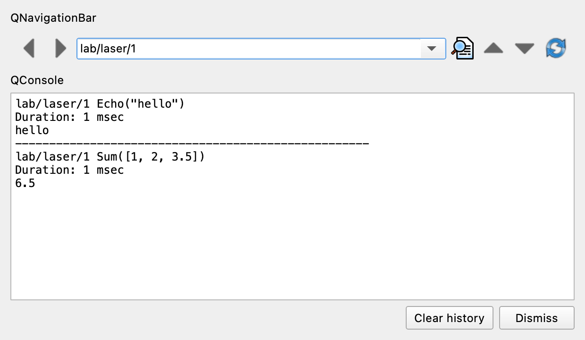
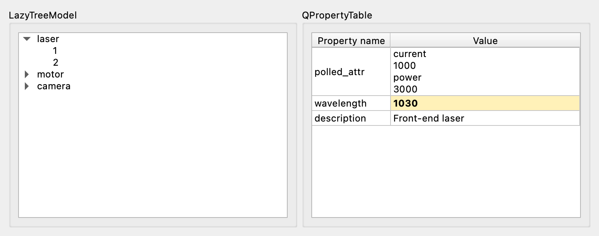
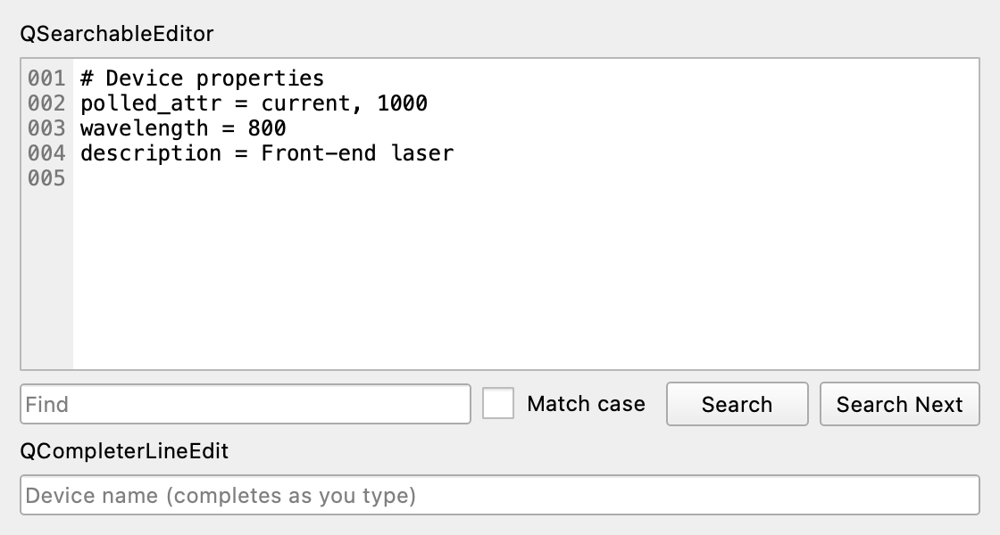
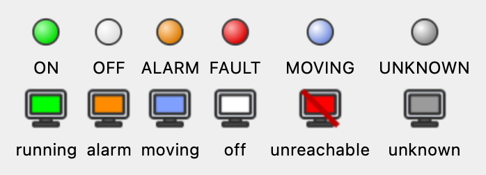

# Building blocks

Generic pieces used by the tools and by Jive-like applications: a console, a
navigation bar, a lazy tree model, property tables, editors, icons and colours.
The last section shows how to write your own Tango widget.

```python
from PyQTango.widgets import (QConsole, QNavigationBar, NavigationHistory, LazyTreeModel, TreeNode,
                              PropertyTableModel, QPropertyTable, QMultiLineDelegate, QCodeEditor,
                              QSearchableEditor, QCompleterLineEdit, state_style, state_qcolors,
                              quality_qcolor)
from PyQTango.widgets.icons import state_icon, host_icon, ball_icon
```

## QConsole and QNavigationBar



`QConsole` is an append-only monospace log (Jive's Test Device console) with
**Clear history** and, with `dismiss_button=True`, **Dismiss** (`dismissed`
signal). `print(text)` appends the text as is (add `\n` yourself), `separator()`
prints a dashed line, and `max_lines` (default 10000) bounds memory.

```python
console = QConsole(dismiss_button=True)
console.print("lab/laser/1 Sum([1, 2, 3.5])\n")
console.print("6.5\n")
console.separator()
```

`QNavigationBar` is a toolbar with Back, Forward, a search combo that keeps a
history of links, Search, Previous and Next occurrence, and Refresh (Jive's
NavigationBar). It only emits signals: `backRequested`, `forwardRequested`,
`refreshRequested`, `nextRequested`, `previousRequested`, `searchRequested(str)`
and `linkActivated(object)`, for a history link chosen in the combo.
`NavigationHistory` is the matching back/forward history.

```python
nav = QNavigationBar()
history = NavigationHistory()

def go(path):
    history.record(path)
    nav.addLink("/".join(path), path)          # text shown, data returned by linkActivated
    nav.enableBack(history.can_go_back())
    nav.enableForward(history.can_go_forward())

nav.searchRequested.connect(lambda text: search(text))
nav.linkActivated.connect(go)
nav.backRequested.connect(lambda: show(history.back()))
```

## LazyTreeModel and QPropertyTable



`LazyTreeModel` is a tree model that loads children on demand in a worker thread
(the base of Jive's trees). Subclass `TreeNode` and implement `populate(context)`,
which runs in the worker and returns the child nodes. Avoid Qt in that method.
While it runs, the node shows a "Loading..." row; if it raises, an error row.

```python
class Domain(TreeNode):
    def populate(self, context):              # worker thread
        return [Family(name) for name in context.get_device_family("{0}/*".format(self.label))]

class Family(TreeNode):
    def populate(self, context):
        domain = self.parent.label
        return [TreeNode(m, leaf=True) for m in context.get_device_member("{0}/{1}/*".format(domain, self.label))]

model = LazyTreeModel(Domain("lab"), context=tango.Database())
view = QtWidgets.QTreeView()
view.setModel(model)

model.find_path(["laser", "1"], lambda index: view.setCurrentIndex(index))   # loads along the way
```

Also: `refresh(index)` loads a node again, `ensure_loaded(index, callback)`,
`insert_child(index, node)` adds a node that exists only in the view (Jive's
"Create free property"), and `node_changed(node)` repaints one. Override
`display()`, `icon()` and `tooltip()` on the nodes. Signals: `nodeLoaded(index)`,
`loadFailed(index, error)`.

`QPropertyTable` and `PropertyTableModel` show Tango properties, whose values are
string arrays, one item per line (Jive's property tables). Modified values are
bold on a tinted background, with the stored value in the tooltip, until you save
them. Cells are edited in a multi-line editor (`QMultiLineDelegate`): **Enter**
adds a line, **Ctrl+Enter** commits, **Esc** cancels.

```python
model = PropertyTableModel()
model.set_properties([("polled_attr", ["current", "1000"]), ("wavelength", "800")])
table = QPropertyTable(model=model)

model.modifiedChanged.connect(save_button.setEnabled)
changes = model.changed()                     # {"wavelength": ["1030"]}
model.mark_clean()                            # after writing them; revert() drops them
```

## Editors



* `QCodeEditor` is a plain-text editor with line numbers and
  `find_text(text, match_case=False, from_start=False)`.
* `QSearchableEditor` is a `QCodeEditor` with a search row (text, Match case,
  Search, Search Next); `text()` / `setText()`.
* `QCompleterLineEdit(items, match="contains")` is a line edit with a popup of
  matching items (case-insensitive, `"contains"` or `"prefix"`); it emits
  `itemChosen(str)`.

```python
devices = QCompleterLineEdit(items=["lab/laser/1", "lab/motor/1", "lab/motor/2"])
devices.itemChosen.connect(open_device)
```

## Icons and colours



Icons are painted at any size and screen scale from the ATK colours:

* `state_icon(state)`: a ball in the colour of a `DevState` (or its name);
* `host_icon(state)`: Astor's host icon for a host state (`"running"`, `"alarm"`,
  `"moving"`, `"off"`, `"unreachable"`, `"unknown"`...);
* `ball_icon(colour)`: a ball of any colour.

For your own widgets, `state_style(state)` returns the style sheet of a state
label, `state_qcolors(state)` the `(background, text)` colours of a state, and
`quality_qcolor(quality)` the colour of an attribute quality.

```python
item.setIcon(0, state_icon(tango.DevState.ON))
label.setStyleSheet(state_style("ALARM"))
```

## Writing your own Tango widget

Combine `TangoAttributeWidget` with any Qt widget and implement the hooks you
need. The mixin binds the widget to the shared model and keeps the reference
count. It also replays the configuration and the last value when you bind, so a
new widget on a running attribute shows data at once.

```python
from PyQTango.qt import QtWidgets
from PyQTango.widgets import TangoAttributeWidget, model_name_property

class QPercentBar(TangoAttributeWidget, QtWidgets.QProgressBar):
    """ A numeric attribute between its min_value and max_value, as a bar """

    modelName = model_name_property()          # settable from Qt Designer

    def __init__(self, parent=None):
        QtWidgets.QProgressBar.__init__(self, parent)
        TangoAttributeWidget.__init__(self)

    def on_config(self, cfg):                  # tango.AttributeInfoEx
        try:
            self.setRange(int(float(cfg.min_value)), int(float(cfg.max_value)))
        except ValueError:
            self.setRange(0, 100)

    def on_value(self, value):                 # PyQTango.models.AttrValue
        if value.value is not None:
            self.setValue(int(value.value))

    def on_error(self, err):                   # ErrorRecord, or None when it clears
        self.setEnabled(err is None)

bar = QPercentBar()
bar.setModel("lab/laser/1/current")
```

| Hook | Called with |
| --- | --- |
| `on_config(cfg)` | The configuration, on binding and on every configuration change |
| `on_value(value)` | Each new value: `value.value`, `value.w_value`, `value.quality`, `value.time` |
| `on_error(err)` | A read error, or `None` when reads work again |
| `on_write_done(err)` | The result of a write on the attribute (`None` on success) |
| `on_own_write_done(err)` | The result of a write started by this widget |
| `on_model_cleared()` | The widget was unbound |

To write, call `self.write(value)`, or `self.write_latest(value)` to send only
the latest of fast successive values. `attributeConfig()`, `attributeValue()`
and `attributeError()` return the last of each, `set_point(value)` the value a
setter should show, and `tooltip_text()` the standard tooltip.

For device widgets, `TangoDeviceWidget` gives `setDevice(name)` and the hook
`on_device_changed(device)`, which receives a `TangoDeviceModel` (or `None`).
Its `attribute(name)` returns the shared model of one attribute, and its
`state_model` and `status_model` those of State and Status; use `deviceName =
device_name_property()` for Designer.
