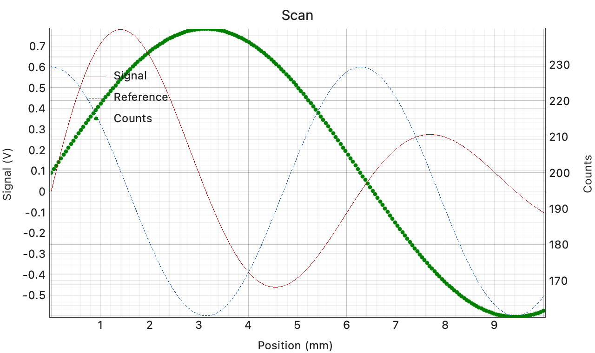
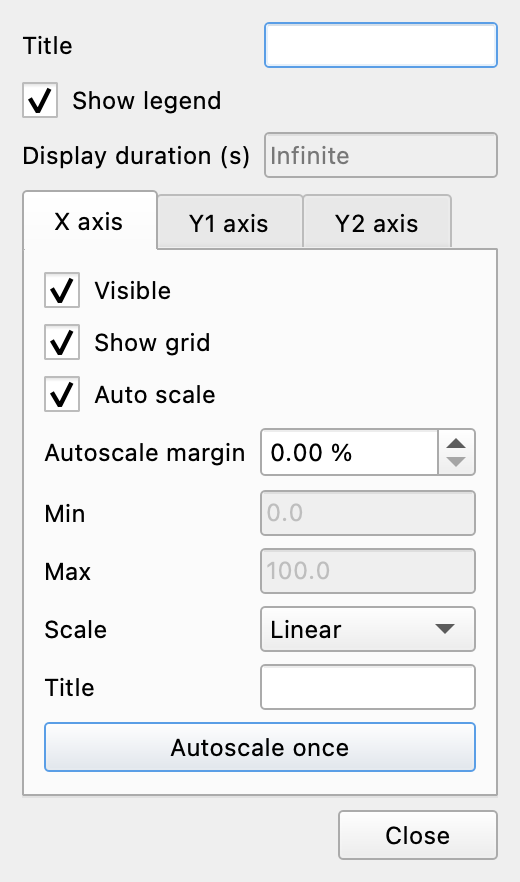
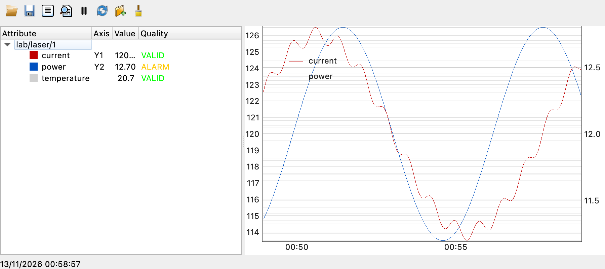
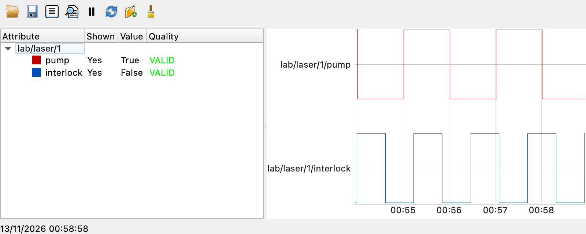
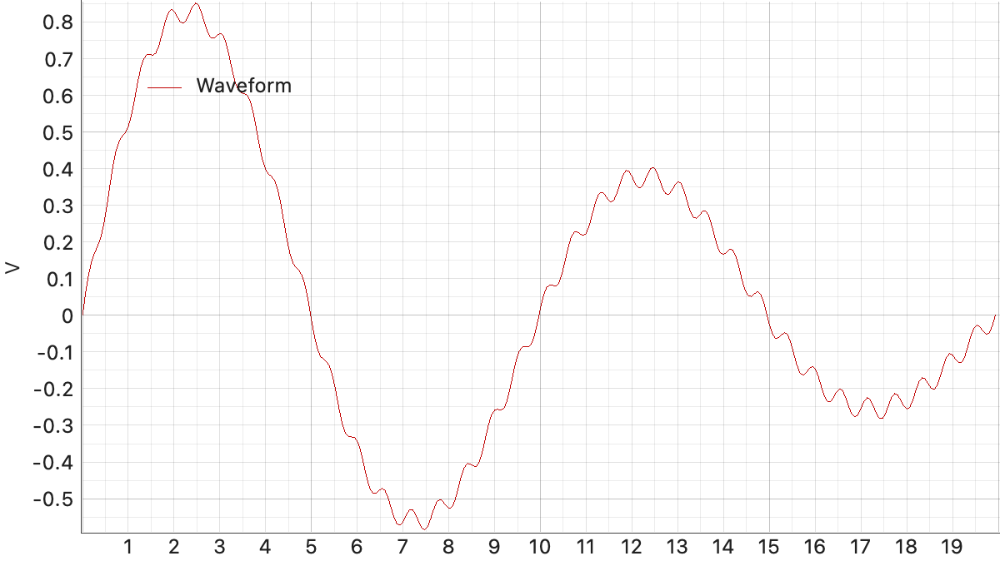
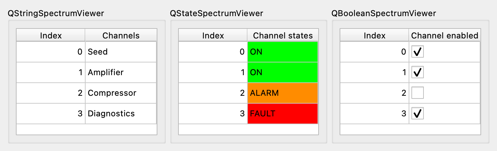
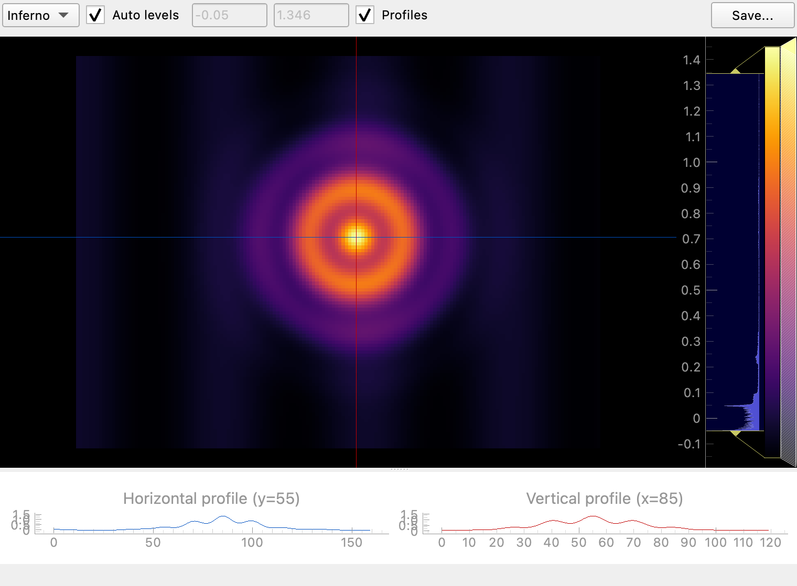
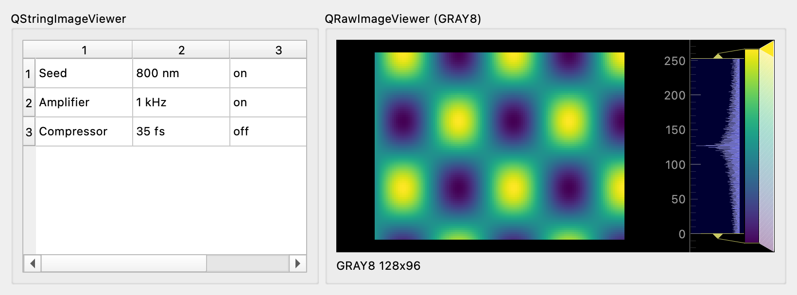

# Charts, trends, spectra and images

These widgets draw with [pyqtgraph](https://www.pyqtgraph.org/) (`pip install .[plot]`)
and are imported from their modules:

```python
from PyQTango.widgets.plot import QTangoChart, DataView, AxisSettings
from PyQTango.widgets.trend import QTrend, QBooleanTrend, SEL_NONE, SEL_X, SEL_Y1, SEL_Y2
from PyQTango.widgets.spectrum import (QSpectrumViewer, QStringSpectrumViewer, QStateSpectrumViewer,
                                       QBooleanSpectrumViewer)
from PyQTango.widgets.image import QImageViewer, QStringImageViewer, QRawImageViewer
```

## QTangoChart



A chart of named curves on one or two Y axes (ATK `JLChart`). It has no Tango
binding of its own: the trend and the spectrum viewer are built on it, and you
can draw anything with `set_curve(name, y, x=None)`, which creates the curve or
replaces its data.

```python
import numpy as np

chart = QTangoChart(title="Scan")
x = np.linspace(0, 10, 200)
chart.set_curve("Signal", np.sin(x) * np.exp(-x / 6), x=x)
chart.set_curve("Reference", 0.6 * np.cos(x), x=x, view=DataView(color="#0050c0", line_style=2))
chart.set_curve("Counts", 200 + 40 * np.sin(x / 2), x=x, axis="y2",
                view=DataView(color="#008000", marker=1, marker_size=4, width=0))
chart.set_axis_labels(x="Position (mm)", y="Signal (V)", y2="Counts")
```

Without `x`, points are drawn at 0, 1, 2... (`x_offset` shifts them).

**Curve style.** A `DataView` per curve (ATK `JLDataView`): `color`, `width`,
`line_style` (0 Solid, 1 Dot, 2 Dash, 3 Long Dash, 4 Dash + Dot), `marker` (0 None,
1 Dot, 2 Box, 3 Triangle, 4 Diamond, 5 Star, 6 Vertical line, 7 Horizontal line,
8 Cross, 9 Circle, 10 Square), `marker_size`, `marker_color`, `view_type` (line
or bar), `bar_width`, `fill`, `fill_color`, a transform `y' = a0 + a1*y + a2*y²`,
`visible`, `step` and the `axis` (`"y1"` left, `"y2"` right). Change a curve's
look with `chart.view(name)` and then `chart.refresh_view(name)`.

**Axes.** `chart.axes["x" | "y1" | "y2"]` are `AxisSettings`: `visible`,
`autoscale` (or fixed `minimum`/`maximum`), autoscale `margin`, `log`, `grid`,
`title`. Call `chart.apply_axes()` after changing them. A time X axis
(`QTangoChart(time_axis=True)` or `set_time_axis(True)`) shows dates, and
`set_display_duration(seconds)` keeps the last N seconds in view.

**Zoom.** The mouse wheel zooms, dragging pans; `set_rect_zoom(True)` makes the
left drag draw a zoom rectangle. `zoom_back()` returns to the previous zoom level,
`reset_zoom()` to the axis settings, and `zoom_to(x=(a, b), y1=..., y2=...)` zooms
from code.

**Context menu** (right click), as in JLChart: Chart properties, Data View
properties, Save data File and Load data File (CSV), Show table, Show statistics,
Zoom back, Print Chart, Save a snapshot (PNG or SVG). The same actions exist as
methods: `show_chart_properties()`, `show_view_properties(name)`, `save_data(path)`,
`load_data(path)`, `show_table()`, `show_statistics()`, `print_chart()`, `snapshot(path)`.



The Chart properties dialog (title, legend, display duration, one tab per axis)
and the Data View dialog apply every change at once, as JLChart does.

`settings()` returns the chart configuration as a dict and `apply_settings(d)`
restores it. Signals: `zoomed()`, `curvesChanged()`, `viewChanged(str)`,
`durationChanged(float)`.

## QTrend



Scalar attributes against time (ATK `Trend`). On the left, a tree of the
attributes by device, with their axis, value and quality; on the right, a
`QTangoChart` with a time axis. Click the Axis column to move an attribute
between no axis, Y1 and Y2; right-click an attribute for Set to X, Add to Y1/Y2,
Remove, Show min/max alarm, Graphic properties and Attribute properties.

```python
trend = QTrend(refresh_ms=1000)
trend.add_attribute("lab/laser/1/current")                 # Y1 by default
trend.add_attribute("lab/laser/1/power", SEL_Y2)
trend.add_attribute("lab/laser/1/temperature", SEL_NONE)   # listed, not drawn
trend.add_attribute("lab/laser/1/waveform[10]")            # one element of a spectrum
trend.set_show_alarm("lab/laser/1/power", "max", True)     # dashed alarm line
trend.set_display_duration(600)                            # last 10 minutes (default 5)
```

* **Samples** come from the shared attribute models: each new value (change
  event or polled read) is a sample at its device time stamp. An attribute on
  events that does not change is repeated at each refresh period, so its curve
  reaches "now". States plot as their integer code, enums as their index,
  booleans as 0 or 1; errors and invalid values leave a gap.
* **Buffers** hold one day of samples at the refresh period (at most two million
  per attribute), so a trend can run for days with bounded memory.
* **Refresh period and source**: `set_refresh_interval(ms)` and
  `set_source(tango.DevSource.DEV | CACHE | CACHE_DEV)`. The trend *requests* its
  period from the shared models: other widgets on the same attributes keep at
  least their own rate.
* **Monitoring**: `stop()`, `start()` (toolbar Start/Stop), `set_offline(True)` to
  browse the data without new samples, `reset()` to clear the buffers.
* **XY mode**: `set_selected(name, SEL_X)` plots the other attributes against it.
* **Configuration**: `save_configuration(path)` and `load_configuration(path)`
  (JSON, `.trend.json`); ATK trend files (`key:value`) load as well.
* **Data**: Save data File / Load data File (CSV) cover the whole buffers.

The toolbar has Load and Save configuration, Global settings, Zoom, Start/Stop
monitoring, Set refresh interval, Add new attribute and Reset trend; its menu also
has Source, Hide toolbar, Off line mode, View errors and Diagnostic.

Signals: `itemsChanged()`, `sampled()`, `redrawn()`, `monitoringChanged(bool)`.

## QBooleanTrend



Boolean attributes as stepped lanes on one time axis (ATK `BooleanTrend`). It has
the same API as `QTrend`; attributes are shown or hidden instead of moved between
axes.

```python
lanes = QBooleanTrend()
lanes.add_attribute("lab/laser/1/pump")
lanes.add_attribute("lab/laser/1/interlock")
```

## QSpectrumViewer



A numeric spectrum on a `QTangoChart` (ATK `NumberSpectrumViewer`), with the set
point as a second curve for a writable attribute (`show_set_point=False` to hide
it). The X axis runs from `Xmin` to `Xmax` as in ATK: `x[i] = xmin + i * (xmax - xmin) / n`.

```python
spectrum = QSpectrumViewer()
spectrum.setModel("lab/laser/1/waveform")
spectrum.setXRange(0, 20)                                     # constant range...
spectrum.setXModels("lab/laser/1/xmin", "lab/laser/1/xmax")   # ...or followed from two attributes
spectrum.load_x_axis_properties()     # ...or from the attribute properties, as ATKPanel does
```

`load_x_axis_properties()` reads the database attribute properties
`XminAttribute`/`XmaxAttribute` (attribute names) or `Xmin`/`Xmax` (numbers).
Everything else (zoom, menu, styles, CSV) is the `QTangoChart` above.

## List viewers



Non-numeric spectra as lists, one row per element:

* `QStringSpectrumViewer`: strings;
* `QStateSpectrumViewer`: state names in the ATK colours;
* `QBooleanSpectrumViewer`: check marks.

```python
names = QStringSpectrumViewer()
names.setModel("lab/laser/1/channels")
states = QStateSpectrumViewer()
states.setModel("lab/laser/1/channel_states")
```

## QImageViewer



A numeric image (ATK `NumberImageViewer`), rows down the Y axis:

* colour maps: Gray, Viridis, Inferno, Plasma, Magma, Cividis, Turbo, Fire;
* automatic levels, or fixed ones typed in the toolbar or set with `set_levels(lo, hi)`;
* a histogram with draggable levels;
* zoom and pan with the mouse; the value under the cursor in the bottom label;
* horizontal and vertical profiles through a point (`show_profiles(True)`); drag
  the two lines on the image to move the point, or call `set_profile_position(x, y)`;
* Save as PNG or TIFF (with the colour map) or CSV (raw values).

```python
camera = QImageViewer()
camera.setModel("lab/laser/1/camera")
camera.set_colormap("Inferno")
camera.show_profiles(True)

viewer = QImageViewer(toolbar=False)    # any 2D array, no Tango
viewer.set_data(np.random.rand(120, 160))
```

Infinite and NaN values are drawn as empty pixels and left out of the
automatic levels.

## QStringImageViewer and QRawImageViewer



* `QStringImageViewer` shows a string image as a table (ATK `StringImageTableViewer`).
* `QRawImageViewer` decodes a `DevEncoded` attribute (JPEG, GRAY8, GRAY16, RGB24)
  into a `QImageViewer`. `decode_encoded(value)` does the decoding alone.

```python
table = QStringImageViewer()
table.setModel("lab/laser/1/settings_table")
snapshot = QRawImageViewer()
snapshot.setModel("lab/laser/1/snapshot")
```
