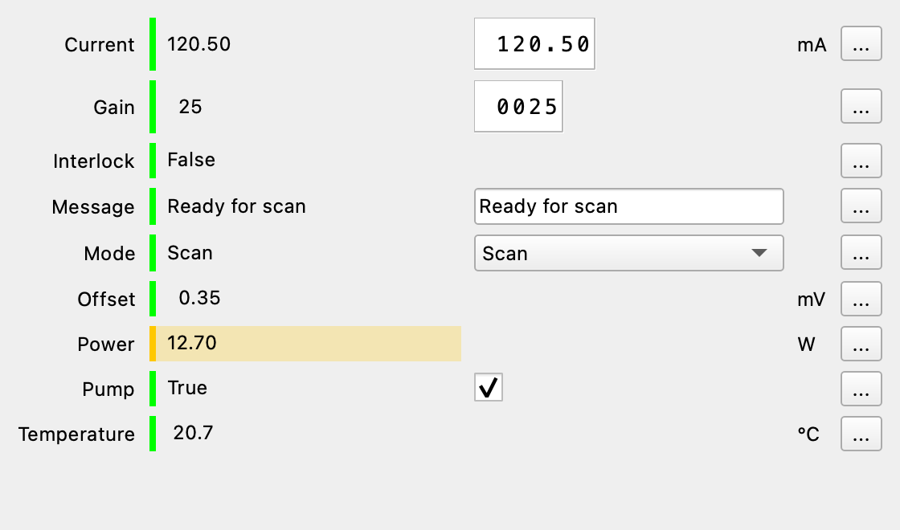
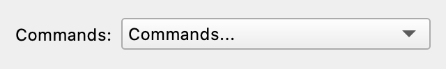

# Device widgets

Widgets bound to a whole device. Bind them with `setDevice("dom/fam/mem")` (or the
`deviceName` property in Qt Designer). For the State and Status header,
`QStateStatusViewer`, see [Attribute viewers](attribute-viewers.md#qstatelabel-qstatusviewer-and-qstatestatusviewer).

```python
from PyQTango.widgets import QScalarListViewer, QCommandCombo
```

## QScalarListViewer



A grid with one row per scalar attribute (ATK `ScalarListViewer`, the body of
ATKPanel): label, value, setter, unit and a "..." button that opens the
[attribute property dialog](tools.md#qattributepropertydialog).

* `setDevice(name)` lists every scalar attribute of the device except State and
  Status, in the background. `setModels([...])` shows an explicit list of full
  attribute names instead, possibly from several devices.
* The value column uses [`create_viewer`](attribute-viewers.md#create_viewer) and
  the setter column [`create_setter`](setters.md#create_setter).
* When the database attribute property `values` of a numeric or string attribute
  lists the allowed values (one per line, or comma separated), its setter is a
  combo of those values.

| Property / method | Default | Meaning |
| --- | --- | --- |
| `operatorView` | `False` | Hide EXPERT attributes |
| `settersVisible` | `True` | Show the setter column |
| `propertyButtonsVisible` | `True` | Show the "..." buttons |
| `propertiesEditable` | `True` | Let the property dialog write (ATK `modifProp`) |
| `setReadOnly(True)` | | Hide setters and "..." buttons, read-only property dialogs (ATKPanel `-ro`) |

Signals: `loaded(int)` when the rows are built (number of rows), `valuesLoaded(int)`
when the allowed-value combos are in place.

```python
panel = QScalarListViewer()
panel.setDevice("lab/laser/1")
panel.setOperatorView(True)            # hide EXPERT attributes

summary = QScalarListViewer()
summary.setModels(["lab/laser/1/power", "lab/motor/1/position", "lab/camera/front/exposure"])
```

## QCommandCombo



Runs any command of a device from a combo box (ATK `CommandComboViewer`). The
first item, "Commands...", is a prompt; choosing a command:

* runs it at once when it takes no argument;
* otherwise asks for the argument with Jive's syntax (`1,2,3`, `[1,2][a,b]`,
  `"text"`...), with an example of the expected input;
* shows the result in a popup when the command returns something, and the full
  Tango error stack when it fails.

`operatorView` hides EXPERT commands. Signals: `loaded(int)` (number of commands),
`executed(str, object)` (command, result) and `failed(str, object)` (command,
`ErrorRecord`).

```python
commands = QCommandCombo()
commands.setDevice("lab/laser/1")
commands.setOperatorView(True)
commands.executed.connect(lambda cmd, result: print(cmd, "->", result))

commands.run("Sum", "1, 2, 3.5")      # from code: the argument as text, Jive syntax
```

The popups go through three hooks you can replace, for instance to show results
in a console instead: `ask_argin(info)` returns the argument text or `None` to
cancel, `show_result(command, text)` and `show_failure(command, err)`.

```python
commands.show_result = lambda cmd, text: console.print("{0}: {1}\n".format(cmd, text))
```
