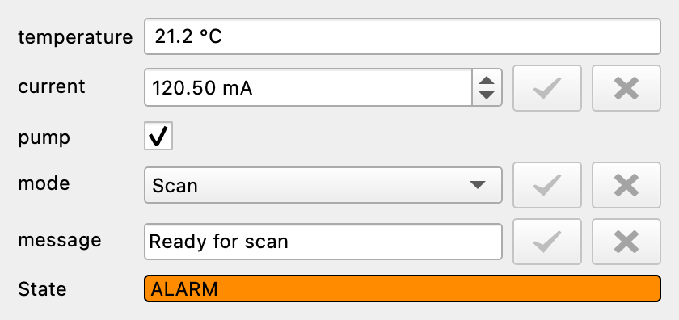
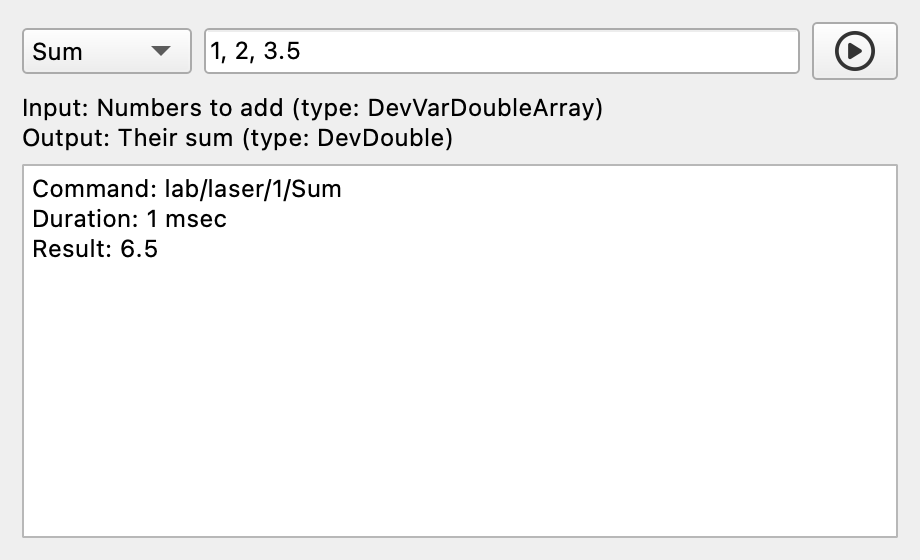
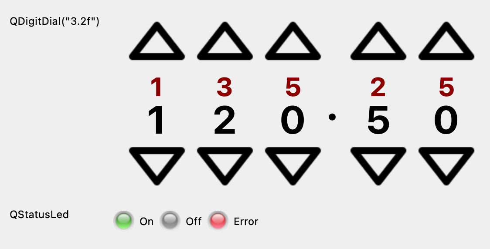
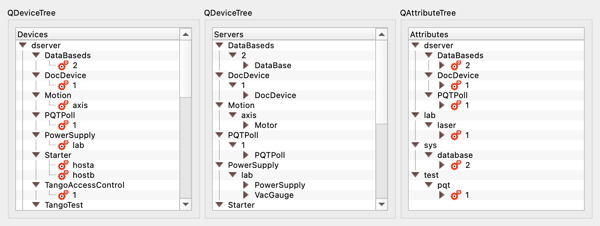

# Legacy widgets

The widgets of PyQTango 0.1, kept with the same API for the existing lab GUIs.
They are now built on the shared, event-aware models: they work whether or not
the server pushes events, and they never block the GUI. New code should prefer
the widgets of the other pages; the table at the end says which.

```python
from PyQTango import (QAttribute, QCommandExecuter, QDigitDial, QStatusLed, QTangoMainWindow, QTangoDialog,
                      QDeviceTree, QAttributeTree, TreeItem, DeviceItem, AttributeItem, ServerItem, TangoUtil)
```

## QAttribute



A one-line read/write widget for one attribute. It picks its editor from the attribute:

* a spin box for numbers with a minimum and a maximum, a line edit for other
  numbers and for strings, a check box for booleans, a combo for enums, a coloured
  label for states;
* spectra and images as read-only text.

For a writable attribute, editing the value enables two buttons: ✓ writes it, ✗
gives up and shows the device value again. While you edit, new values from the
device turn the text red instead of replacing it.

```python
w = QAttribute()
w.setTangoAttribute("lab/laser/1/current")
w.updated.connect(lambda da: print(da.value))   # each new value, as a tango.DeviceAttribute
print(w.label(), w.tangoAttribute())
w.shutdown()                                    # unbind (same as setModel(None))
```

## QCommandExecuter



Runs any command of a device: choose it, see its input and output types, type
the argument (Jive syntax: `1, 2, 3.5`, `[1,2][a,b]`, `"text"`...), press
**Execute**. The result, or the full error stack, shows below with the duration.

```python
ex = QCommandExecuter()
ex.setDevice("lab/laser/1")
ex.executed.connect(lambda cmd, result, ms: print(cmd, result, ms))
```

## QDigitDial and QStatusLed



`QDigitDial(format)` is a large digit display with up and down arrows on each
digit. `format` is `"Nd"` (integer, N digits) or `"N.Mf"` (N integer digits, M
decimals). It shows the read value in large digits (`setValue()`) and the set
value in small red digits above it (`setWriteValue()`). Clicking an arrow changes
the set value by that digit's step, and a double click asks for a new value. Both
emit `valueChangeSignal(new, old)`; the application writes the value.

```python
dial = QDigitDial("3.2f")
dial.setValue(120.5)
dial.setWriteValue(120.5)
dial.valueChangeSignal.connect(lambda new, old: proxy.write_attribute("current", new))
```

`QStatusLed` is a LED with four states: `QStatusLed.Off`, `On`, `Blinking` and
`Error`. Set it with `setState()` and read it with `getState()` or the `state`
property.

```python
led = QStatusLed()
led.setState(QStatusLed.Blinking)
```

## QTangoMainWindow and QTangoDialog

A `QMainWindow` and a `QDialog` for GUIs that subscribe to Tango events
themselves:

* Subscribe with `self.eventCallback` as the callback, and override
  `on_TangoEvent(self, event)`. The event (`tango.EventData`) reaches it in the
  GUI thread, through the `tangoEvent` signal, so the handler can update widgets.
* `scaleUi(self)`, called after `setupUi(self)`, scales a window built from a
  `pyuic` class (and its widgets) for HiDPI screens.
* `setIcon(ui, pixmap)` sets the window icon. `getImage(name)` loads an image
  from the `icons` folder of the application, or from the application folder.

```python
class LaserWindow(QTangoMainWindow, Ui_LaserWindow):   # Ui_LaserWindow from pyuic
    def __init__(self):
        QTangoMainWindow.__init__(self)
        self.setupUi(self)
        self.scaleUi(self)
        self.dev = tango.DeviceProxy("lab/laser/1")
        self.dev.subscribe_event("current", tango.EventType.CHANGE_EVENT, self.eventCallback)

    def on_TangoEvent(self, event):                  # GUI thread
        if not event.err:
            self.current.setText("{0:.2f}".format(event.attr_value.value))
```

With the [attribute widgets](attribute-viewers.md) you do not need this: they
subscribe, fall back to polling and update themselves.

## QDeviceTree and QAttributeTree



`QDeviceTree` shows the devices registered in a Tango database by domain, family
and member (`structure=QDeviceTree.ByDevice`, default), by server
(`QDeviceTree.ByServer`) or by class (`QDeviceTree.ByClass`). `QAttributeTree`
shows the attributes of the running devices; it checks every device first,
which takes time on a large control system.

Both read the database in the constructor. Pass `load_async=True` to show the
tree at once, empty, and fill it from a worker thread; the `loaded` signal tells
when it is filled. `QDeviceTree` also accepts a ready `dev_list` (from
`TangoUtil.getAllRegisteredDevices()`), so several trees can share one database
read.

```python
from PyQTango import QDeviceTree, DeviceItem, ServerItem, TangoUtil

devices = TangoUtil.getAllRegisteredDevices()
by_server = QDeviceTree(label="Server", structure=QDeviceTree.ByServer, dev_list=devices)
by_device = QDeviceTree(label="Device", dev_list=devices)

def selected(selected, deselected):
    for index in by_device.selectionModel().selectedIndexes():
        item = index.internalPointer()
        if isinstance(item, DeviceItem):
            print("device", item.getDevice())
        elif isinstance(item, ServerItem):
            print("server", item.getInstance())

by_device.selectionModel().selectionChanged.connect(selected)

attributes = QAttributeTree(label="Attributes", load_async=True)
```

`TangoUtil` (`PyQTango.core.tangoutil`) has the database helpers the trees use:
`getAllRegisteredDevices()`, `getAllLiveDevices()`, `getAllLiveAttributes()`,
`checkDevicesAreLive(dev_list)` and `getAllLiveDevicesByClass(classes)`. They block:
call them from a worker thread in a GUI (`PyQTango.models.run_async`).

## Moving to the new widgets

| Legacy | New |
| --- | --- |
| `QAttribute` | [`QValueLabel`](attribute-viewers.md#qvaluelabel) to read; a [setter](setters.md) or [`QAttributeWheelEditor`](setters.md#qwheeleditor-and-qattributewheeleditor) to write |
| `QCommandExecuter` | [`QCommandCombo`](device-widgets.md#qcommandcombo) |
| `QDigitDial` | [`QAttributeWheelEditor`](setters.md#qwheeleditor-and-qattributewheeleditor), bound to the attribute |
| `QStatusLed` | [`QBooleanLabel`](attribute-viewers.md#qbooleanlabel) or [`QStateLabel`](attribute-viewers.md#qstatelabel-qstatusviewer-and-qstatestatusviewer) |
| `QTangoMainWindow` event handling | Attribute widgets bound with `setModel()` |
| `QDeviceTree`, `QAttributeTree` | [`LazyTreeModel`](building-blocks.md#lazytreemodel-and-qpropertytable) for trees that load as they open |
