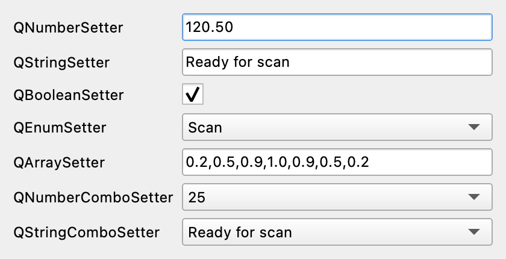
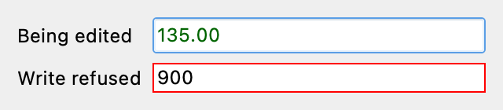
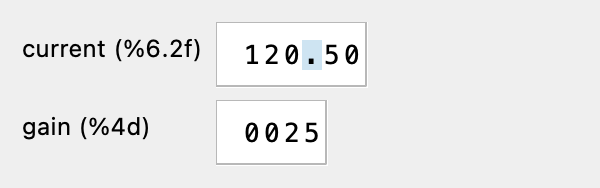
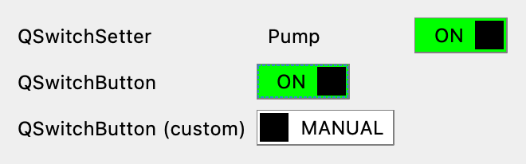

# Setters

Widgets that write an attribute. Bind them with `setModel("dom/fam/mem/attr")`.

```python
from PyQTango.widgets import (QNumberSetter, QStringSetter, QBooleanSetter, QEnumSetter, QArraySetter,
                              QNumberComboSetter, QStringComboSetter, QWheelEditor,
                              QAttributeWheelEditor, QSwitchButton, QSwitchSetter, create_setter)
```

All setters:

* write asynchronously: the GUI never waits for the device;
* show the **set point** when it is meaningful (memorized attribute, write-only
  attribute, or already written by this process), and the read value otherwise.
  Set `setter.setPointMode = "always"` for ATK's behaviour (always the set point)
  or `"never"` (always the read value);
* are disabled when the attribute is not writable, or when they are unbound.

## Line, check box and combo setters



| Widget | Attribute | Writes |
| --- | --- | --- |
| `QNumberSetter` | numeric scalar | on Enter. Accepts hex (`0x1f`) and exponents; checks `min_value`/`max_value` |
| `QStringSetter` | `DevString` | on Enter, or on every keystroke with `setWriteOnEdit(True)` |
| `QBooleanSetter` | `DevBoolean` | on each click of the check box |
| `QEnumSetter` | `DevEnum` | when an item is chosen; the items are the enum labels |
| `QArraySetter` | spectrum or image | on Enter, with Jive's syntax: `1,2,3` or `[1,2][3,4]` |
| `QNumberComboSetter` | numeric scalar | when an item is chosen among allowed values |
| `QStringComboSetter` | `DevString` | when an item is chosen among allowed values |

```python
current = QNumberSetter()
current.setModel("lab/laser/1/current")

mode = QEnumSetter()
mode.setModel("lab/laser/1/mode")

gain = QNumberComboSetter(values=["1", "10", "25", "100"])
gain.setModel("lab/laser/1/gain")

message = QStringSetter()
message.setModel("lab/laser/1/message")
message.setWriteOnEdit(True)          # no Enter needed; writes stay in order
```

### Editing and errors



Line setters show text being edited in dark green; new values from the device do
not overwrite it. **Enter** writes, **Esc** goes back to the device value, and
Enter on unedited text writes nothing. A value that cannot be parsed, or that is
out of range, is refused with a red frame and the reason in the tooltip. When the
device refuses a write, the setter shows the device value again with a red frame
and the error in the tooltip.

Each setter reacts only to the result of its own writes: a failed write from
another widget on the same attribute does not disturb an edit in progress.

### Confirmation

Any of these setters can ask before writing (ATK `needsConfirmation`):

```python
current.setNeedsConfirmation(True)
current.setConfirmMessage("Set {attribute} from {current} to {new}?")   # optional
```

The default question is "Change {attribute} from {current} to {new}?". Replace
`ask_confirmation(message)` on the instance to ask in another way; it returns
`True` to go ahead.

## QWheelEditor and QAttributeWheelEditor



A compact number editor with one wheel per digit (ATK `NumberScalarWheelEditor`):

* hover a digit to see its up and down arrows, click them or use the mouse wheel;
* keyboard: **Left/Right** select a digit, **Up/Down** change it, **0-9** type it,
  **Enter** commits, **Esc** reverts;
* the value stays within the range, and the sign cell flips the sign when the
  minimum is negative.

`QAttributeWheelEditor` takes the number of integer digits and decimals from the
attribute `format` (`%6.2f` gives 3 integer digits and 2 decimals) and the range
from `min_value`/`max_value`. When a value needs more integer digits, the editor
widens instead of hiding them. As in ATK, every click writes at once; with fast
clicks only the latest value is sent after the write in flight, so the device
receives them in order.

```python
wheel = QAttributeWheelEditor()
wheel.setModel("lab/laser/1/current")
wheel.setWriteOnChange(False)         # write on Enter instead of on every click
```

`QWheelEditor` is the same editor without Tango:

```python
w = QWheelEditor(integer_digits=3, decimals=1)
w.setRange(-50, 150)
w.setValue(21.5)
w.setWriteOnChange(True)
w.valueCommitted.connect(lambda v: print("apply", v))   # valueEdited(float), editReverted()
```

## QSwitchButton and QSwitchSetter



`QSwitchButton` is a painted, animated on/off switch (ATK `SwitchButton`), with
no Tango. Click or **Space** toggles it. `switched(bool)` is emitted only for user
toggles; `toggled` also fires for changes made by the program.

| Property | Default | Meaning |
| --- | --- | --- |
| `onText`, `offText` | `"ON"`, `"OFF"` | Texts of the two sides |
| `onColor`, `offColor` | green, white | Colours of the two sides; the text colour follows |
| `needsConfirmation` | `False` | Ask Yes/No before toggling |
| `warningMessage` | `"Switch from {current} to {next}?"` | The question; `{current}` and `{next}` are replaced |

`QSwitchSetter` is a title and a switch bound to a writable `DevBoolean`
attribute (ATK `BooleanScalarSwitchButton`). The title is the attribute label,
or `trueLabel`/`falseLabel`, or a fixed `title`. The switch follows the read value,
writes on each toggle, is disabled while the attribute is in error, and goes
back with the error in the tooltip when a write fails. `showQuality` colours the
title with the attribute quality.

```python
pump = QSwitchSetter(onText="RUN", offText="STOP", needsConfirmation=True)
pump.setModel("lab/laser/1/pump")
pump.setWarningMessage("Switch the pump {next}?")

mode = QSwitchButton(onText="AUTO", offText="MANUAL")
mode.switched.connect(lambda on: print("auto" if on else "manual"))
```

## create_setter

`create_setter(cfg, parent=None, wheel=True, values=None)` returns the setter for
an attribute configuration (`tango.AttributeInfoEx`), or `None` when the attribute
is not writable:

| Attribute | Setter |
| --- | --- |
| spectrum or image | `QArraySetter` |
| `values` given, numeric | `QNumberComboSetter` (when every value is a number) |
| `values` given, string | `QStringComboSetter` |
| boolean | `QBooleanSetter` |
| enum | `QEnumSetter` |
| string | `QStringSetter` |
| numeric, fixed-point format and `wheel=True` | `QAttributeWheelEditor` |
| other numeric (`%e`, `%g` formats) | `QNumberSetter` |

```python
setter = create_setter(cfg, parent)
if setter is not None:
    setter.setModel("lab/laser/1/" + cfg.name)
```
