# Dialogs and tools

Ready-made windows for engineering panels and Jive/Astor-like tools: property
editing, diagnostics, errors, the black box, polling, long operations, result
tables and Starter dialogs.

## QAttributePropertyDialog

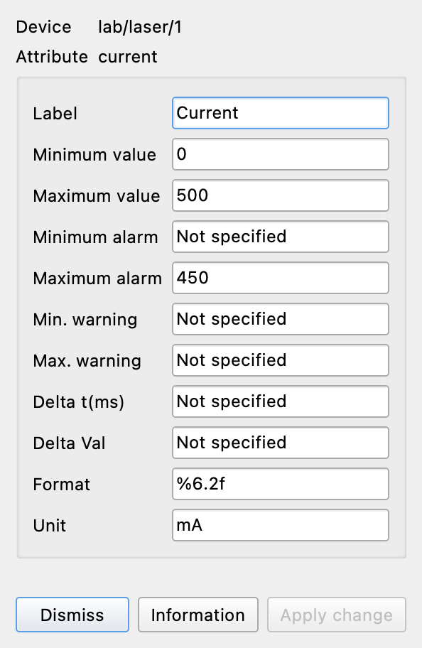

Edits the main properties of one attribute (ATK `SimplePropertyFrame`): label,
minimum and maximum value, alarm and warning limits, RDS delta t and delta value,
format and unit. **Apply change** writes them with `set_attribute_config` in the
background; every widget on the attribute picks up the new configuration.
**Information** shows the whole configuration as text. With `read_only=True` the
fields cannot be edited and there is no Apply button.

```python
from PyQTango.widgets import QAttributePropertyDialog

dlg = QAttributePropertyDialog("lab/laser/1/current", parent)
dlg.applied.connect(lambda err: print("applied" if err is None else err.message))
dlg.show()
```

Signals: `loaded(object)` with the configuration, `applied(object)` with `None`
or the `ErrorRecord`. The [scalar list viewer](device-widgets.md#qscalarlistviewer)
opens it from its "..." buttons.

## QRefresherDiagnostic

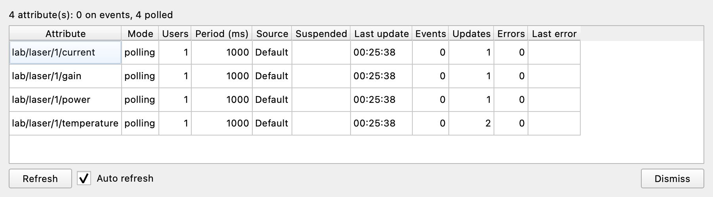

What every live attribute model is doing (ATK `ATKDiagnostic`): events or
polling, number of users, polling period and source, whether all users are
suspended (frozen), last update, event and update counts, errors and the last
error. The table refreshes every second while visible. `models=[...]` limits it
to some attributes, for instance those of one window.

```python
from PyQTango.widgets import QRefresherDiagnostic

diag = QRefresherDiagnostic(models=["lab/laser/1/current", "lab/laser/1/power"])
diag.show()
```

## QErrorDialog and QErrorHistory

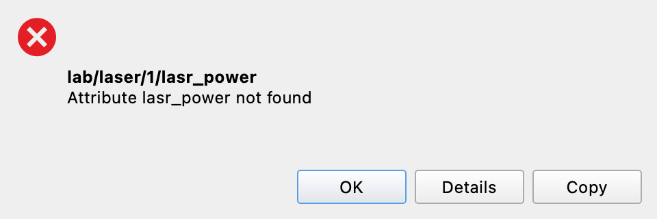

`QErrorDialog(record, title)` shows the first error description, with the full
Tango error stack under **Details** (ATK `ErrorPane`). `show_error(parent, error,
title)` opens it modally for a `DevFailed`, any exception or an `ErrorRecord`.

```python
from PyQTango.widgets import show_error

try:
    proxy.write_attribute("current", 900)
except tango.DevFailed as e:
    show_error(window, e, "Write failed")
```

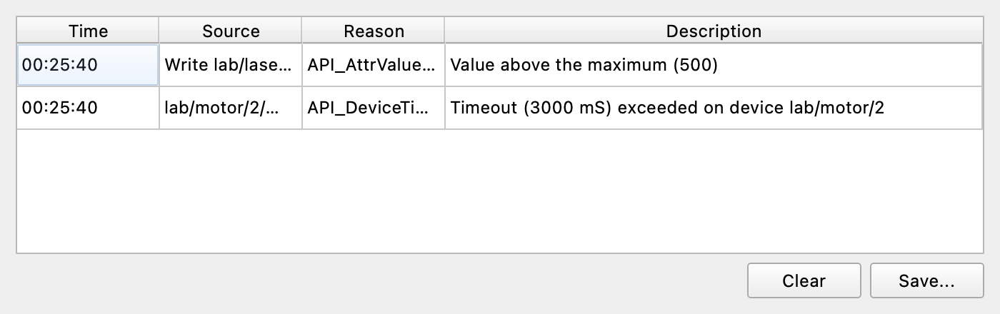

`QErrorHistory` lists every error collected by the PyQTango models (failed reads,
writes, subscriptions, commands), newest first, with **Clear** and **Save**. A
double click opens the error in a `QErrorDialog`. The errors are kept in
`PyQTango.models.error_history()`, which an application can also read.

```python
from PyQTango.widgets import QErrorHistory

history = QErrorHistory()
history.show()
```

## QBlackBoxView and QBlackBoxDialog

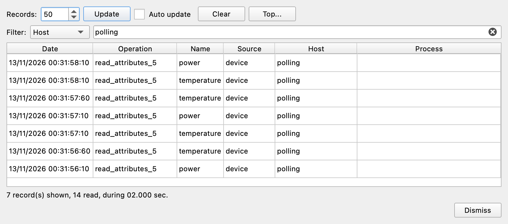

The black box of a device (Astor's BlackBoxTable): date, operation, name, source,
host and process of the last requests, newest first. **Auto update** reads it
again every second and keeps the records the device has already dropped from its
ring; a warning shows when reads no longer overlap (records lost). The filter keeps
the rows whose chosen column contains a text, and **Top...** counts operations,
names, sources, hosts and processes over the time span of the records.

```python
from PyQTango.widgets import QBlackBoxDialog, QBlackBoxView

QBlackBoxDialog("lab/laser/1", parent, depth=100).show()     # its own window, read when shown

view = QBlackBoxView("lab/laser/1")                          # to embed in a panel
view.set_auto_update(True)
```

## QPollingProfiler and QPollingProfilerDialog

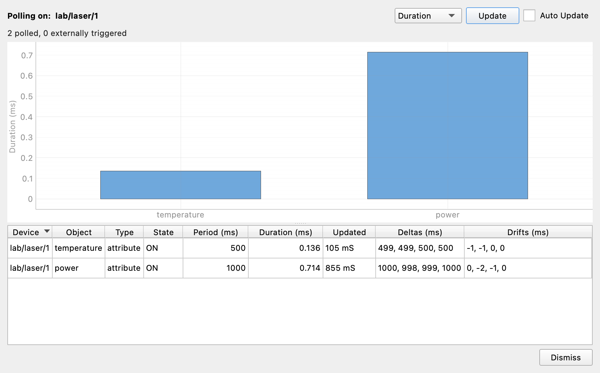

The polling profile of one or more devices (Astor's PollingProfiler), read from
the admin device's `DevPollStatus` in the background. The table lists every
polled object with its period, the time its last reading took, the time since
its last update, and the deltas and drifts of its last records. The chart shows,
as Astor does:

* **Duration**: the last reading time of each object, against its period;
* **Polling Drift**: delta minus period for each recorded delta;
* **History**: when each object was last read, on a time line.

Objects whose last delta exceeds 1.5 × the period, or whose reading takes longer
than the period, are shown as FAULT. **Auto Update** reads again every 2 s.

```python
from PyQTango.widgets.profiler import QPollingProfilerDialog   # needs pyqtgraph

QPollingProfilerDialog(["lab/laser/1", "lab/motor/1"], parent).show()
```

## QPollingPanel and QConfigPanel

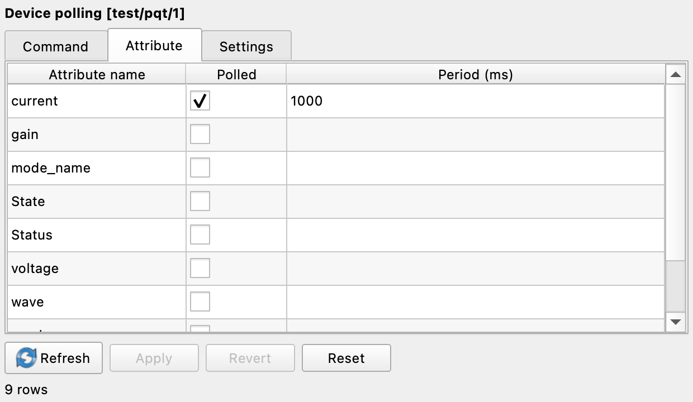

`QPollingPanel` is Jive's device polling panel. Its tabs are:

* **Command**: commands without argument, with Polled and Period (ms);
* **Attribute**: every attribute, with Polled and Period (ms);
* **Settings**: `poll_old_factor` and `poll_ring_depth`, which are database properties.

Edits stay pending, in bold on a tinted background, until **Apply**, which
writes them on every shown device in the background with a progress dialog.
**Revert** drops the pending edits, **Refresh** reads the devices again, and
**Reset** deletes the stored polling configuration (applied at the next server
restart). Editing a period ticks Polled, as in Jive. Right-click offers Enable
polling, Disable polling and Set period for the selected rows.

```python
from PyQTango.widgets import QPollingPanel
from PyQTango.core.db import DatabaseService

panel = QPollingPanel()
panel.show_devices(DatabaseService(), ["lab/laser/1"])        # several devices: Apply writes on all
panel.set_read_only(True)                                    # optional
```

`DatabaseService()` uses `TANGO_HOST`; pass `"host:port"` for another database.

`QConfigPanel` is the base of this panel, for building your own tabbed
configuration editors. You declare the tabs with `ConfigTab` and `ConfigColumn`
(text or check-box columns) and right-click actions with `ConfigAction`. Then
implement two methods that run in a worker thread:

* `load(dbs, device)` returns `{tab_key: [{"name": ..., column_key: value, ...}, ...]}`;
* `write(job, dbs, devices, pending, rows)` applies
  `pending = {tab_key: [(row name, column key, new value), ...]}`.

`validate(pending)` (GUI thread) can return an error text that stops Apply.
Signals: `loaded()` and `applied()`.

```python
from PyQTango.widgets import QConfigPanel, ConfigTab, ConfigColumn

class EventPanel(QConfigPanel):
    def __init__(self, parent=None):
        tab = ConfigTab("attribute", "Change event", [ConfigColumn("abs", "Absolute"),
                                                      ConfigColumn("rel", "Relative")])
        QConfigPanel.__init__(self, [tab], parent)

    def load(self, dbs, device):                       # worker thread
        ...
        return {"attribute": [{"name": "current", "abs": "0.1", "rel": ""}]}

    def write(self, job, dbs, devices, pending, rows):  # worker thread
        for tab, changes in pending.items():
            for name, key, value in changes:
                ...
```

## QJobProgressDialog

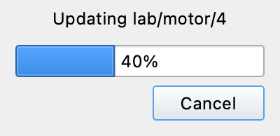

Runs a `PyQTango.models.Job` (a function in a worker thread that reports
progress) with a progress dialog and **Cancel**. At the end it shows the errors
the job collected, or the error that stopped it.

```python
from PyQTango.models import Job
from PyQTango.widgets import QJobProgressDialog

def apply(job, devices):                       # runs in a worker thread
    for i, d in enumerate(devices):
        if job.cancelled:
            break
        job.set_progress(100 * i // len(devices), "Updating " + d)
        try:
            tango.DeviceProxy(d).poll_attribute("current", 1000)
        except tango.DevFailed as e:
            job.add_error(e, d)                # reported at the end, the job goes on

QJobProgressDialog.run(Job(apply, devices, title="Applying polling settings"), window)
```

## QTableDialog and QTextDialog

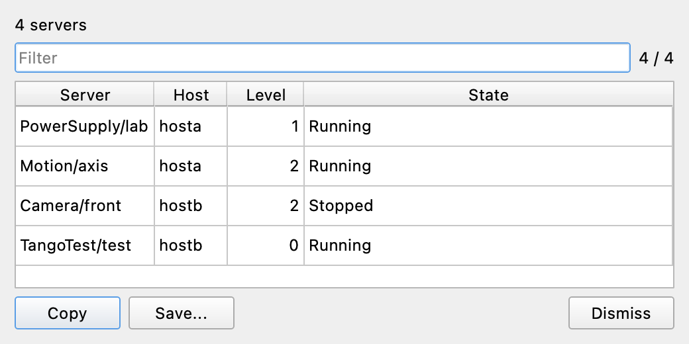

`QTableDialog(title, headers, rows, parent, info="")` shows a sortable table of
results with a filter box, **Copy** and **Save** as CSV (Astor's PopupTable).
Numbers sort as numbers. `activated` is emitted with the row on a double click.

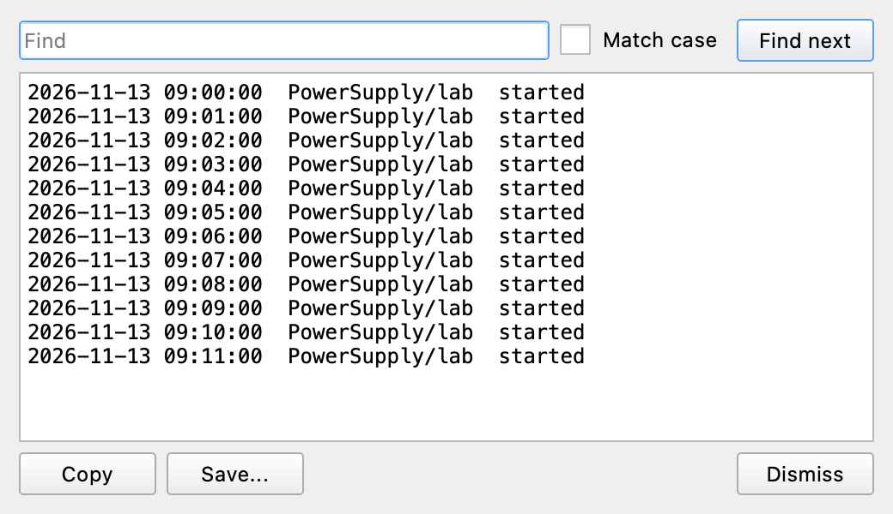

`QTextDialog(title, text, parent, html=False)` shows plain text or HTML with
**Find**, **Copy** and **Save**. Large texts are loaded in chunks, so a 64 KB
log does not freeze the window.

```python
from PyQTango.widgets import QTableDialog, QTextDialog

QTableDialog("Servers", ["Server", "Host", "Level"], [["PowerSupply/lab", "hosta", 1]], window).show()
QTextDialog("Starter log", log_text, window).show()
```

## QMultiChangeDialog

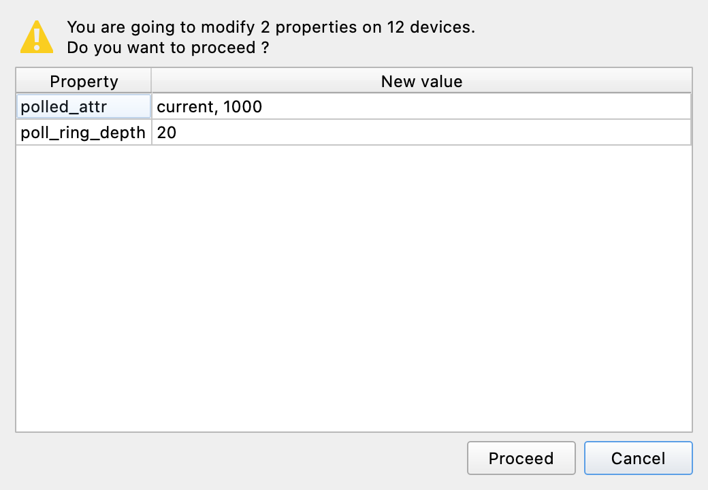

Jive's confirmation before a change that touches several devices: "You are going
to modify 2 properties on 12 devices.", with the list of what will be written.
`confirm_changes(parent, rows, n_devices, extra="", item="property")` returns
`True` for **Proceed**. Use `item="attribute"` (written) or `item="command"`
(executed, with input parameters) to change the wording.

```python
from PyQTango.widgets.confirm import confirm_changes

if confirm_changes(window, [("poll_ring_depth", "20")], len(devices)):
    ...
```

## Starter dialogs

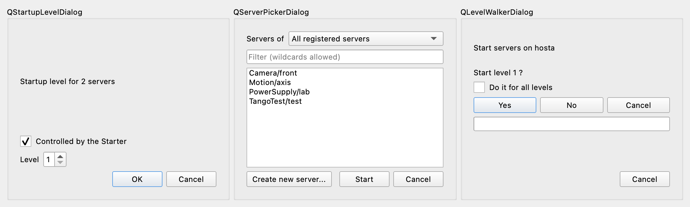

From Astor, for applications that control Starters:

* `QStartupLevelDialog(servers, parent, nb_levels=5, level=1, controlled=True)`
  asks for the controlled flag and startup level of one or more servers;
  `values()` returns `(controlled, level)`. `ask_levels_policy(parent, count)` asks
  how to set levels when more than four servers start (not controlled, the same
  level for all, or ask for each).
* `QServerPickerDialog(servers, parent, host_servers=None)` picks servers to start,
  with a wildcard filter, the servers of another host, and a "Create new server..."
  button (`createRequested` signal). `selected()` returns the chosen servers.
* `QLevelWalkerDialog(action, hosts_levels, command, parent)` starts or stops
  servers level by level, asking Yes / No / Cancel for each level (with "Do it for
  all levels"), and shows a table of results at the end (`finished_walk(list)`).
  `command(host, level)` runs in a worker thread.

```python
from PyQTango.core.levels import START
from PyQTango.widgets.levels import QLevelWalkerDialog

def start_level(host, level):                  # worker thread
    starter_proxy(host).command_inout("DevStartAll", level)

walker = QLevelWalkerDialog(START, {"hosta": [1, 2, 3]}, start_level, window)
walker.show()
walker.start()
```
